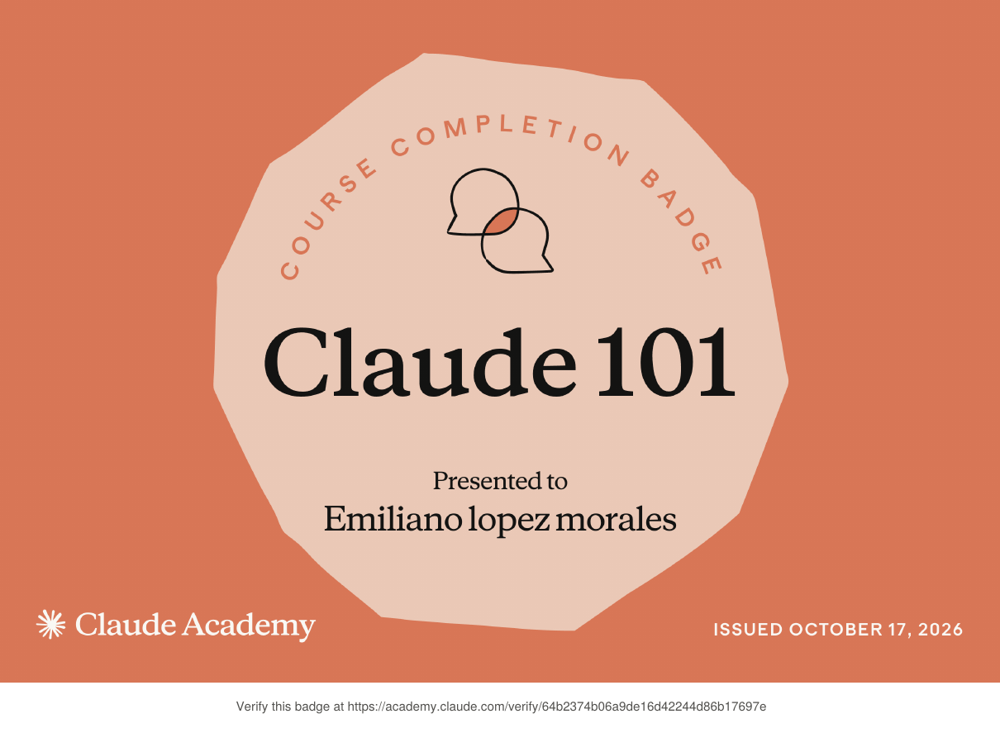
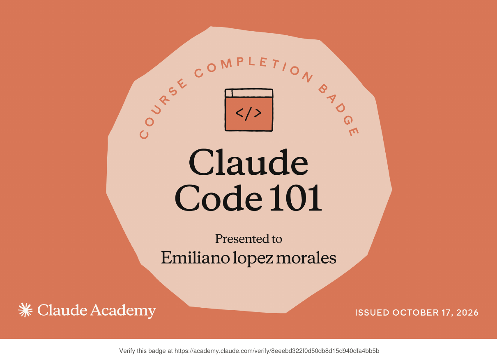

### Emiliano

Construyo apps y herramientas usando IA como parte central de mi flujo de trabajo. Me interesa el diseño cuidado y llevar ideas de concepto a producto funcional, desde apps de macOS hasta páginas web.

### Certificaciones

